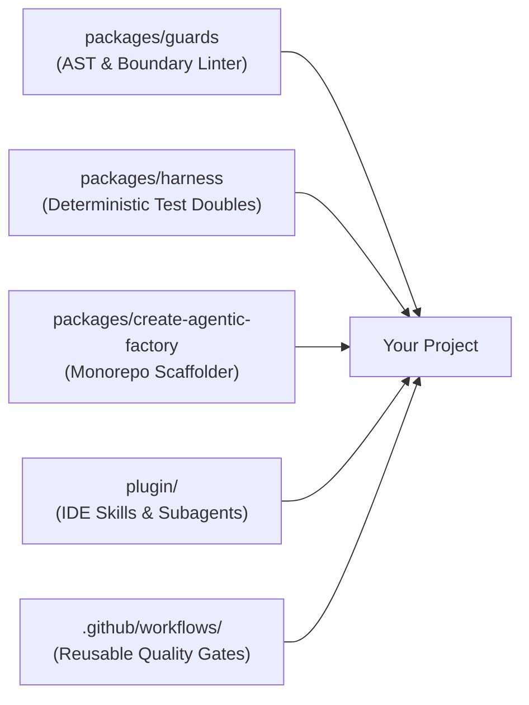

# Agentic Factory

> **The Project-Agnostic Software Factory and Harness Engine for Agentic Software Development.**

[](LICENSE)
[](tsconfig.base.json)

---

## What is Agentic Factory?

When building software with AI coding agents, **the AI model is only 10%** of the equation: the remaining **90% is the harness** (tooling, AST guardrails, synthetic test doubles, and architectural boundaries).

`agentic-factory` provides that missing 90%:
* **Automated Guardrails (`@agentic-factory/guards`):** Pure-TypeScript AST cycle detection, package boundary enforcement, plain-language UX checks, and secret scanning.
* **Synthetic Testing Harness (`@agentic-factory/harness`):** Seeded PRNG, virtual clocks, and contract test runners (zero PII, zero flakiness).
* **Agent Loop (`@agentic-factory/loop`):** Issue in, test-first pull request out. Red and green phases, gate ladder, protected paths, weekly budget, and a run ledger, all driven by `.factoryrc.json`.
* **Antigravity IDE Plugin:** Pre-bundled SDLC skills and autonomous subagents (`SpecArchitect`, `HarnessEngineer`, `GuardEnforcer`, `AdversarialReviewer`).
* **Turnkey Scaffolder (`create-agentic-factory`):** Monorepo generator configured with composite TypeScript, BDD docs, and boundary rules.

---

## Quick Start: 4 Ways to Use It

### 1. Scaffold a New Project

Generate a production-ready, agent-friendly project in one command:

```bash
# From NPM (published):
npx create-agentic-factory my-app --arch modular-monorepo

# Or directly from source:
git clone https://github.com/vantrangradion/agentic-factory.git
cd agentic-factory && pnpm install && pnpm build
node packages/create-agentic-factory/dist/cli.js my-app --arch modular-monorepo
```

This sets up:
* Composite `tsconfig.json` & `pnpm-workspace.yaml` (sub-second incremental builds)
* Pure domain contract package (`packages/types`)
* Seeded synthetic scenario runner (`packages/testing`)
* Standard docs (`spec.md`, `user-stories.md` with BDD Gherkin, ADR decisions)
* Invariant guard configuration (`.factoryrc.json`)

---

### 2. Add Guards to an Existing Project

Add deterministic architectural guards to any current codebase:

**Step 1: Install the guard engine:**
```bash
pnpm add -D @agentic-factory/guards
```
*(Or link locally: `"@agentic-factory/guards": "link:../agentic-factory/packages/guards"`)*

**Step 2: Generate `.factoryrc.json`:**
```bash
pnpm agentic-guards init                      # style-neutral defaults
pnpm agentic-guards init --preset plain-ux    # also enforce plain-language UX copy
```

Or write it by hand. The engine is generic; everything project-specific is data:
```json
{
  "$schema": "https://agentic-factory.dev/schema.json",
  "extends": ["agentic-factory/recommended"],
  "project": { "name": "my-app", "architecture": "modular-monorepo", "languages": ["typescript", "python"] },
  "guards": {
    "noCycles": { "rootDir": "packages" },
    "boundaries": [
      {
        "package": "packages/domain",
        "disallowImportsFrom": ["packages/adapters", "packages/infrastructure"]
      }
    ]
  }
}
```

* **Languages:** files are routed to a language adapter by extension. Supported today: `typescript` (TS/JS, via the TypeScript compiler, an optional peer dependency) and `python` (no dependencies). Omit `project.languages` to check every supported language present.
* **Presets:** `agentic-factory/recommended` (cycles, secrets, TODO links, commented-out code, dead exports) and `agentic-factory/plain-ux` (jargon list, no em dashes or emojis in user-facing copy). `extends` also accepts relative paths, so an organization can share one base config. Your own settings always win; arrays replace rather than merge.
* **Coverage:** every guard runs on every supported language, except dead exports, which is TypeScript-only for now and reports skipped files instead of passing silently.

**Step 3: Run the guards:**
```bash
pnpm agentic-guards run
```

---

### 3. Enable the Antigravity IDE Plugin

Equip your Antigravity IDE with global factory intelligence across all your projects:

```bash
# Clone the repository
git clone https://github.com/vantrangradion/agentic-factory.git ~/agentic-factory

# Link to Antigravity's global plugin directory
mkdir -p ~/.gemini/config/plugins
ln -sfn ~/agentic-factory/plugin ~/.gemini/config/plugins/agentic-factory
```

**Instant access to skills & subagents in chat:**
* `/agentic-sdlc`: SDLC rules and harness engineering principles.
* `/factory-harness`: 5-phase harness setup checklists.
* `/architecture-decision`: ADR trade-off analyzer.
* `/user-story-authoring`: Spec-to-BDD story decomposition.
* `/milestone-watchdog`: Rebuild a story batch's state from git and GitHub, report what needs attention, and safely resume interrupted or rejected work.
* **Subagents:** `SpecArchitect`, `HarnessEngineer`, `GuardEnforcer`, `AdversarialReviewer`.
* **The 7-Step Story Lifecycle:** Accept (Definition of Ready) -> Red Phase (TDD) -> Plan Approval (draft PR, blocking) -> Green Phase (Self-Healing) -> Guard Phase (`agentic-guards`) -> Independent Review (by exception, advisory) -> Ready for Review & Human Sign-Off. While one plan waits for approval, work continues on stories that do not depend on it.

---

### 4. Enforce Quality Gates in GitHub CI

Block regressions automatically on every Pull Request:

```yaml
# .github/workflows/ci.yml
name: CI Quality Gate
on: [push, pull_request]

jobs:
  agentic-guards:
    uses: vantrangradion/agentic-factory/.github/workflows/reusable-guard-ci.yml@main
```

---

### 5. Run the Agent Loop on GitHub

Label an issue `agent:ready` and the loop writes failing tests and a plan; approve the plan and it implements it, with no human edits in between:

1. **Budget check.** Below 80% of the weekly cap every issue runs; up to 100% only bug issues run; above that the loop waits for Monday.
2. **Red phase.** The agent writes tests only. The loop reverts any non-test change and requires the red gate to fail. The failing tests are committed.
3. **Plan approval (blocking).** The loop opens a draft PR with the failing tests and the agent's plan, labels the issue `agent:plan-review`, and stops. A person approves by adding `agent:plan-approved`, or rejects by commenting on the PR and adding `agent:ready` again; the next red phase gets those comments. Set `"plan": { "approval": "none" }` to run red and green in one go.
4. **Green phase.** The agent implements on the approved branch. The loop restores any edit to the approved tests, reverts protected paths, and runs every gate in order, cheapest first. A failing gate's output goes back to the agent for the next attempt.
5. **Independent review (by exception).** For issues labelled `risky` or `security` (`agent.review`), a separate reviewer session checks the diff against the issue and classifies findings as gap, bug, verification-miss or scope-drift. It is advisory and never blocks a merge; high and medium findings get one fix round, kept only if every gate still passes.
6. **Result.** All gates pass: the PR is marked ready, with the red and green runs, review findings, tokens and cost. Otherwise: a draft PR, an `agent:needs-human` label and a comment with the failing output.
7. **Ledger.** Every run is stored as one JSON file on the `factory-ledger` branch. `agentic-loop report` renders the weekly budget and metrics page from it.

**Step 1: Install and configure.** `pnpm add -D @agentic-factory/loop`, then add an `agent` section to `.factoryrc.json`:
```json
{
  "agent": {
    "model": "<default model id>",
    "routes": [{ "labels": ["chore", "docs"], "model": "<smaller model id>" }],
    "context": ["AGENTS.md", "docs/spec.md"],
    "gates": [
      { "name": "build", "run": "pnpm build" },
      { "name": "guard", "run": "pnpm guard" },
      { "name": "test", "run": "pnpm test" }
    ],
    "tdd": { "redGate": "test" },
    "setup": "pnpm install --frozen-lockfile",
    "protectedPaths": ["guards/**", "e2e/**", "bench/**"],
    "maxAttempts": 3,
    "plan": { "approval": "required" },
    "review": { "when": "labelled", "labels": ["risky", "security"], "maxFixRounds": 1 },
    "budget": {
      "weeklyUsd": 160,
      "utcOffset": "+07:00",
      "pricing": {
        "<default model id>": { "inputPerMTok": 0, "outputPerMTok": 0, "cachedInputPerMTok": 0 },
        "<smaller model id>": { "inputPerMTok": 0, "outputPerMTok": 0, "cachedInputPerMTok": 0 }
      }
    }
  }
}
```
Set `pricing` to your models' real prices (or one price object for all models). Routes are fixed in config and checked in order; the agent never picks its own model. Every run records its model, and the report compares models by cost per run, since tokens are not comparable across models. `pnpm exec agentic-loop check-config` validates the section and lists every problem at once.

**Step 2a: Run it on your own machine (no CI credentials needed).** Uses your `gh` login and your agent login (`agy`), so a seat-based plan works:
```bash
pnpm exec agentic-loop run-issue 42          # one issue, now
pnpm exec agentic-loop watch                 # poll every 60 s for ready issues assigned to you
pnpm exec agentic-loop watch --take-unassigned
```
* **Clean checkout every run:** each issue gets a fresh clone of the default branch under `~/.agentic-loop/<owner>__<repo>/work/`, then `agent.setup` (e.g. `pnpm install --frozen-lockfile`) runs. Your own working copy is never touched.
* **Several watchers:** each teammate runs `watch` with their own login. Assignees are the lock: a watcher only takes issues assigned to it (or unassigned ones with `--take-unassigned`), and if two grab the same issue at once, the login that sorts first keeps it.
* **What the agent can reach:** the agent runs as you, so this is a guard against accidents, not a sandbox. Its sessions and the gates get an environment with no GitHub tokens, an empty `gh` config, no git credential helpers or SSH agent, and pushing from the clone is disabled. The loop pushes afterwards with a token from `gh auth token`, sent as a header and never stored.
* **Git safety:** the loop's own git commands ignore system and global config and switch off hooks, fsmonitor and credential helpers. Before each one, the clone's `.git/config`, `hooks/` and `info/` are reset to a snapshot taken before the agent ran, so nothing the agent plants in `.git` runs with your login.
* **Trusted input only:** issues from outsiders are skipped, and only comments by owners, members and collaborators reach the agent. Pull requests from forks are ignored.
* **Known gaps:** gates run in the working folder, so an ignored file could make them pass; helpers that tests import are not locked; run one watcher per GitHub login.
* **Ctrl+C** stops before the next attempt and still reports on the issue; press it twice to quit at once.

**Step 2b: Or run it in GitHub Actions (needs an API key or Vertex AI credentials).**
```yaml
# .github/workflows/agent-loop.yml
name: Agent Loop
on:
  issues:
    types: [labeled]
  workflow_dispatch:
    inputs:
      issue:
        description: Issue number
        required: true
        type: number

permissions:
  contents: write
  issues: write
  pull-requests: write
  id-token: write

jobs:
  loop:
    if: github.event_name == 'workflow_dispatch' || github.event.label.name == 'agent:ready'
    uses: vantrangradion/agentic-factory/.github/workflows/reusable-agent-loop.yml@<tag>
    with:
      issue-number: ${{ github.event.issue.number || inputs.issue }}
      agy-install-command: '<pinned agy install command>'
    secrets:
      gemini-api-key: ${{ secrets.GEMINI_API_KEY }}
      github-token: ${{ secrets.FACTORY_GH_TOKEN }}
```

* **`github-token`:** use a GitHub App token or fine-grained PAT. Pull requests opened with the default `GITHUB_TOKEN` do not trigger your CI.
* **ADC instead of an API key:** set `use-adc: true` with `gcp-project-id`, `gcp-workload-identity-provider` and `gcp-service-account`. The workflow then sets `AGY_ADC_AUTH=true` and `GOOGLE_CLOUD_QUOTA_PROJECT`.
* **Plan approval in CI:** not supported yet. The `run` command refuses `plan.approval: "required"`; use local mode, or `"none"` for CI.
* **Experimental:** the agent shares the runner with later steps, so run it in a container before relying on it.
* **Not yet run in CI:** the `agy` steps follow the Antigravity docs but have not been tested on a GitHub runner, and ADC with a service account (rather than a person's login) is not confirmed by the docs.
* **Who can start it:** only people who can add labels (triage access or above).
* **What the agent can reach:** the repository checkout and the model credentials. It never receives a GitHub token, and `.factoryrc.json` and `.github/**` are always protected.

---

## Synthetic Testing Example

Write deterministic, zero-PII unit tests using `@agentic-factory/harness`:

```typescript
import { ScenarioBuilder, MockClock, PRNG } from '@agentic-factory/harness';

// Reproducible fixture with deterministic time advance
const clock = new MockClock(1700000000000);
const builder = new ScenarioBuilder<PaymentEvent>(42);

const events = builder.generate(5, (idx, prng, clock) => ({
  transactionId: prng.uuid(),
  amount: prng.nextInt(10, 500),
  timestamp: clock.now(),
})).build();
```

---

## Architecture



---

## License

MIT © Antigravity Engineering
