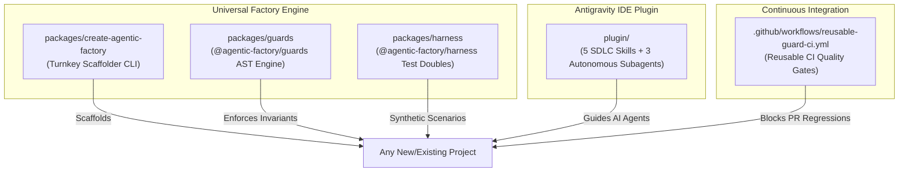

# 🏭 Agentic Factory

> **The Project-Agnostic, Globally Reusable Software Factory Engine for Agentic Software Development.**

[](LICENSE)
[](tsconfig.base.json)

---

## Executive Summary

Per the **Factory Model** framework (*"The New SDLC With Vibe Coding"*, Google 2026):

$$\mathbf{Agent = Model + Harness}$$

* **The Model (~10%):** Off-the-shelf foundation reasoning engine.
* **The Harness (~90%):** The scaffolding, sandboxes, tools, deterministic linters, and synthetic test suites constructed by the developer.
* **Capital Expenditure (CapEx) Inversion:** Invest upfront in reusable harness scaffolding, deterministic AST guardrails, and contract test runners to achieve ultra-low operational cost (OpEx)—sustainable feature delivery with zero regression drift.

`agentic-factory` provides the **universal assembly line**. Any software project (fintech gateway, messaging pipeline, web application, microservice, or CLI tool) can instantiate this factory in seconds.

---

## Architecture & Monorepo Topology



---

## Global Distribution Packages

| Package / Artifact | Type | Purpose |
| :--- | :--- | :--- |
| **`create-agentic-factory`** | NPM CLI Executable | Run `npx create-agentic-factory <target>` to generate a complete Factory codebase. |
| **`@agentic-factory/guards`** | NPM Library & CLI | Deterministic AST checkers: zero import cycles, boundary isolation, UX anti-jargon, secret scan. |
| **`@agentic-factory/harness`** | NPM Library | Deterministic testing doubles: `ScenarioBuilder`, `MockClock`, `PRNG`, and `executeContractSuite`. |
| **`agentic-factory` Plugin** | Antigravity IDE Plugin | Global plugin bundling 5 SDLC skills (`agentic-sdlc`, `factory-harness`, `architecture-decision`, `user-story-authoring`, `practical-test-pyramid`) and 3 subagents. |
| **`reusable-guard-ci.yml`** | GitHub Action | Plug-and-play workflow ensuring no PR can merge with boundary violations or missing TDD evidence. |

---

## 1. Quick Start: Scaffolding a New Project

Any developer on your team can instantiate an Agentic Factory project in one command:

```bash
npx create-agentic-factory my-payment-service --arch modular-monorepo --jargon "deadlock,mutex,sql_error"
```

This generates:
* **`pnpm-workspace.yaml`** and composite **`tsconfig.json`** for sub-second incremental compilation.
* **`packages/types`**: Domain contract package with zero runtime dependencies.
* **`packages/testing`**: Seeded synthetic scenario runner and contract test suites.
* **`docs/`**: `spec.md`, `user-stories.md` (BDD Gherkin), `decisions/` (ADR framework), and `factory-model-setup.md`.
* **`.factoryrc.json`**: Config-driven boundary enforcement and UX jargon dictionary.
* **`.agents/rules/AGENTS.md`**: Inviolable agent rules and privacy invariants.

---

## 2. Using `@agentic-factory/guards` in Any Existing Project

Install the guard engine:

```bash
pnpm add -D @agentic-factory/guards
```

Add `.factoryrc.json` to your project root:

```json
{
  "$schema": "https://agentic-factory.dev/schema.json",
  "project": {
    "name": "my-service",
    "architecture": "modular-monorepo"
  },
  "guards": {
    "noCycles": { "enabled": true, "rootDir": "packages" },
    "boundaries": [
      {
        "package": "packages/domain",
        "disallowImportsFrom": ["packages/adapters", "packages/infrastructure"]
      }
    ],
    "plainLanguage": {
      "targetDirs": ["packages/ui", "packages/cli"],
      "forbiddenTerms": ["deadlock", "db_pool", "internal_id"]
    },
    "secrets": { "enabled": true }
  }
}
```

Run in `package.json`:

```bash
pnpm agentic-guards run
```

---

## 3. Synthetic Testing with `@agentic-factory/harness`

Avoid flakiness, race conditions, or leaking real customer data:

```typescript
import { ScenarioBuilder, MockClock, PRNG } from '@agentic-factory/harness';

// Reproducible test fixture with deterministic time advance
const clock = new MockClock(1700000000000);
const builder = new ScenarioBuilder<PaymentEvent>(42);

const events = builder.generate(10, (idx, prng, clock) => ({
  transactionId: prng.uuid(),
  amount: prng.nextInt(10, 500),
  timestamp: clock.now(),
})).build();
```

---

## 4. Enabling the Global Antigravity Plugin

To equip your Antigravity IDE with global factory intelligence across all workspaces:

```bash
mkdir -p ~/.gemini/config/plugins
ln -sfn $(pwd)/plugin ~/.gemini/config/plugins/agentic-factory
```

Once linked, all your projects immediately have access to:
* `/agentic-sdlc`: Procedural rules from *The New SDLC*.
* `/factory-harness`: 5-Phase setup checklists.
* `/architecture-decision`: ADR trade-off analyzer.
* `/user-story-authoring`: Spec-to-BDD decomposition engine.
* Subagents: `SpecArchitect`, `HarnessEngineer`, and `GuardEnforcer`.

---

## 5. Reusable CI/CD Pipeline

Add `.github/workflows/ci.yml` in your consuming repository:

```yaml
name: CI
on: [push, pull_request]
jobs:
  gates:
    uses: your-org/agentic-factory/.github/workflows/reusable-guard-ci.yml@v1
```

---

## License

MIT © Antigravity Engineering
