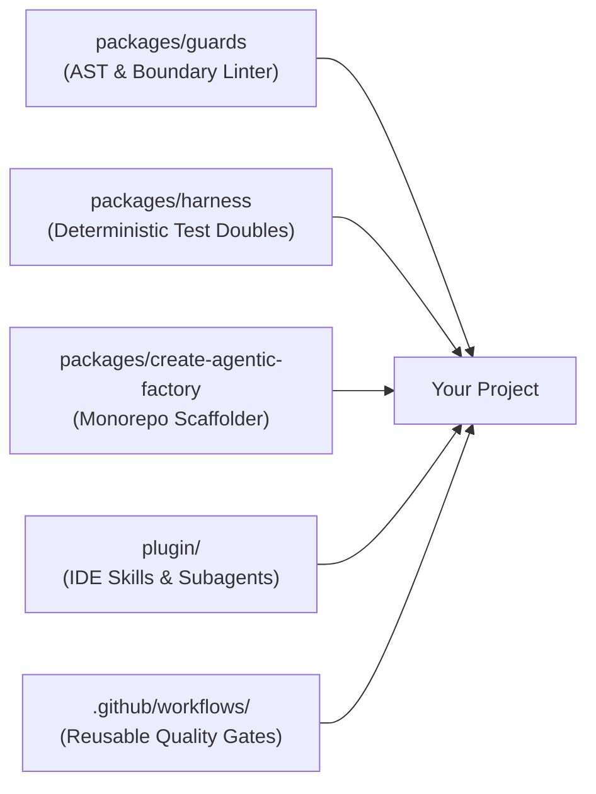

# Agentic Factory

> **The Project-Agnostic Software Factory and Harness Engine for Agentic Software Development.**

[](LICENSE)
[](tsconfig.base.json)

---

## What is Agentic Factory?

When building software with AI coding agents, **the AI model is only 10%** of the equation: the remaining **90% is the harness** (tooling, AST guardrails, synthetic test doubles, and architectural boundaries).

`agentic-factory` provides that missing 90%:
* **Automated Guardrails (`@agentic-factory/guards`):** Pure-TypeScript AST cycle detection, package boundary enforcement, plain-language UX checks, and secret scanning.
* **Synthetic Testing Harness (`@agentic-factory/harness`):** Seeded PRNG, virtual clocks, and contract test runners (zero PII, zero flakiness).
* **Agent Loop (`@agentic-factory/loop`):** Issue in, test-first pull request out. Red and green phases, gate ladder, protected paths, weekly budget, and a run ledger, all driven by `.factoryrc.json`.
* **Antigravity IDE Plugin:** Pre-bundled SDLC skills and autonomous subagents (`SpecArchitect`, `HarnessEngineer`, `GuardEnforcer`, `AdversarialReviewer`).
* **Turnkey Scaffolder (`create-agentic-factory`):** Monorepo generator configured with composite TypeScript, BDD docs, and boundary rules.

---

## Quick Start: 4 Ways to Use It

### 1. Scaffold a New Project

Generate a production-ready, agent-friendly project in one command:

```bash
# From NPM (published):
npx create-agentic-factory my-app --arch modular-monorepo

# Or directly from source:
git clone https://github.com/vantrangradion/agentic-factory.git
cd agentic-factory && pnpm install && pnpm build
node packages/create-agentic-factory/dist/cli.js my-app --arch modular-monorepo
```

This sets up:
* Composite `tsconfig.json` & `pnpm-workspace.yaml` (sub-second incremental builds)
* Pure domain contract package (`packages/types`)
* Seeded synthetic scenario runner (`packages/testing`)
* Standard docs (`spec.md`, `user-stories.md` with BDD Gherkin, ADR decisions)
* Invariant guard configuration (`.factoryrc.json`)

---

### 2. Add Guards to an Existing Project

Add deterministic architectural guards to any current codebase:

**Step 1: Install the guard engine:**
```bash
pnpm add -D @agentic-factory/guards
```
*(Or link locally: `"@agentic-factory/guards": "link:../agentic-factory/packages/guards"`)*

**Step 2: Generate `.factoryrc.json`:**
```bash
pnpm agentic-guards init                      # style-neutral defaults
pnpm agentic-guards init --preset plain-ux    # also enforce plain-language UX copy
```

Or write it by hand. The engine is generic; everything project-specific is data:
```json
{
  "$schema": "https://agentic-factory.dev/schema.json",
  "extends": ["agentic-factory/recommended"],
  "project": { "name": "my-app", "architecture": "modular-monorepo", "languages": ["typescript", "python"] },
  "guards": {
    "noCycles": { "rootDir": "packages" },
    "boundaries": [
      {
        "package": "packages/domain",
        "disallowImportsFrom": ["packages/adapters", "packages/infrastructure"]
      }
    ]
  }
}
```

* **Languages:** files are routed to a language adapter by extension. Supported today: `typescript` (TS/JS, via the TypeScript compiler, an optional peer dependency) and `python` (no dependencies). Omit `project.languages` to check every supported language present.
* **Opt-in guard:** `testOnlyKeys` fails when production code reads a property that only tests ever set (a config key nothing in the product writes, so the real app never takes that path). TypeScript only; add library fields that tests fake to `ignoreKeys`.
* **Presets:** `agentic-factory/recommended` (cycles, secrets, TODO links, commented-out code, dead exports) and `agentic-factory/plain-ux` (jargon list, no em dashes or emojis in user-facing copy). `extends` also accepts relative paths, so an organization can share one base config. Your own settings always win; arrays replace rather than merge.
* **Coverage:** every guard runs on every supported language, except dead exports, which is TypeScript-only for now and reports skipped files instead of passing silently.

**Step 3: Run the guards:**
```bash
pnpm agentic-guards run
```

---

### 3. Enable the Antigravity IDE Plugin

Equip your Antigravity IDE with global factory intelligence across all your projects:

```bash
# Clone the repository
git clone https://github.com/vantrangradion/agentic-factory.git ~/agentic-factory

# Link to Antigravity's global plugin directory
mkdir -p ~/.gemini/config/plugins
ln -sfn ~/agentic-factory/plugin ~/.gemini/config/plugins/agentic-factory
```

**Instant access to skills & subagents in chat:**
* `/agentic-sdlc`: SDLC rules and harness engineering principles.
* `/factory-harness`: 5-phase harness setup checklists.
* `/architecture-decision`: ADR trade-off analyzer.
* `/user-story-authoring`: Spec-to-BDD story decomposition.
* `/milestone-watchdog`: Rebuild a story batch's state from git and GitHub, report what needs attention, and safely resume interrupted or rejected work.
* **Subagents:** `SpecArchitect`, `HarnessEngineer`, `GuardEnforcer`, `AdversarialReviewer`.
* **The 7-Step Story Lifecycle:** Accept (Definition of Ready) -> Red Phase (TDD) -> Plan Approval (draft PR, blocking) -> Green Phase (Self-Healing) -> Guard Phase (`agentic-guards`) -> Independent Review (by exception, advisory) -> Ready for Review & Human Sign-Off. While one plan waits for approval, work continues on stories that do not depend on it.

---

### 4. Enforce Quality Gates in GitHub CI

Block regressions automatically on every Pull Request:

```yaml
# .github/workflows/ci.yml
name: CI Quality Gate
on: [push, pull_request]

jobs:
  agentic-guards:
    uses: vantrangradion/agentic-factory/.github/workflows/reusable-guard-ci.yml@main
```

---

### 5. Run the Agent Loop

Label an issue `agent:ready` and the loop writes failing tests and a plan; approve the plan and it implements it, with no human edits in between:

1. **Budget check.** Below 80% of the weekly cap every issue runs; up to 100% only bug issues run; above that the loop waits for Monday.
2. **Red phase.** The agent writes tests only. The loop reverts any non-test change and requires the red gate to fail. The failing tests are committed.
3. **Plan approval (blocking).** The loop opens a draft PR with the failing tests and the agent's plan, labels the issue `agent:plan-review`, and stops. A person approves by adding `agent:plan-approved`, or rejects by commenting on the PR and adding `agent:ready` again; the next red phase gets those comments. Set `"plan": { "approval": "none" }` to run red and green in one go.
4. **Green phase.** The loop first rebases the approved branch onto the default branch; if that conflicts, it stops and names the files. The agent then implements on the branch, with the approved plan and any PR comments made since the branch's last commit in its prompt. The loop restores any edit to the approved tests, reverts protected paths, and runs every gate in order, cheapest first. A failing gate's output (with local paths made repository-relative) goes back to the agent for the next attempt. Files the build changed that the plan does not name are listed in the PR under "Outside the approved plan" and counted as `plan-drift`; they are not reverted.
   To ask for code changes on a built PR, comment on it and add `agent:plan-approved` again: the loop rebuilds with your comments, without a new plan. Context files and decision records outrank comments: the agent is told to follow them and name the conflict.
5. **Independent review (by exception).** For issues labelled `risky` or `security` (`agent.review`), a separate reviewer session checks the diff against the issue and classifies findings as gap, bug, verification-miss or scope-drift. It is advisory and never blocks a merge; high and medium findings get one fix round, kept only if every gate still passes.
6. **Result.** All gates pass: the PR is marked ready, with the red and green runs, review findings, tokens and cost. Otherwise: a draft PR, an `agent:needs-human` label and a comment with the failing output.
7. **Ledger.** Every run is stored as one JSON file on the `factory-ledger` branch. `agentic-loop report` renders the weekly budget and metrics page from it.

**Step 1: Install and configure.** `pnpm add -D @agentic-factory/loop`, then add an `agent` section to `.factoryrc.json`:
```json
{
  "agent": {
    "model": "<default model id>",
    "routes": [{ "labels": ["chore", "docs"], "model": "<smaller model id>" }],
    "context": ["AGENTS.md", "docs/spec.md"],
    "gates": [
      { "name": "build", "run": "pnpm build" },
      { "name": "guard", "run": "pnpm guard" },
      { "name": "test", "run": "pnpm test" }
    ],
    "tdd": { "redGate": "test" },
    "setup": "pnpm install --frozen-lockfile",
    "protectedPaths": ["guards/**", "e2e/**", "bench/**"],
    "maxAttempts": 3,
    "plan": { "approval": "required" },
    "review": { "when": "labelled", "labels": ["risky", "security"], "maxFixRounds": 1 },
    "budget": {
      "weeklyUsd": 160,
      "utcOffset": "+07:00",
      "pricing": {
        "<default model id>": { "inputPerMTok": 0, "outputPerMTok": 0, "cachedInputPerMTok": 0 },
        "<smaller model id>": { "inputPerMTok": 0, "outputPerMTok": 0, "cachedInputPerMTok": 0 }
      }
    }
  }
}
```
Set `pricing` to your models' real prices (or one price object for all models). Routes are fixed in config and checked in order; the agent never picks its own model. Every run records its model, and the report compares models by cost per run, since tokens are not comparable across models. `pnpm exec agentic-loop check-config` validates the section and lists every problem at once.

**Step 2: Run it on your machine.** Uses your `gh` login and your agent login (`agy`), so a seat-based plan works:
```bash
pnpm exec agentic-loop run-issue 42          # one issue, now
pnpm exec agentic-loop watch                 # poll every 60 s for ready issues assigned to you
pnpm exec agentic-loop watch --take-unassigned
```
* **Clean checkout every run:** each issue gets a fresh clone of the default branch under `~/.agentic-loop/<owner>__<repo>/work/`, then `agent.setup` (e.g. `pnpm install --frozen-lockfile`) runs. Your own working copy is never touched.
* **Several watchers:** each teammate runs `watch` with their own login. Assignees are the lock: a watcher only takes issues assigned to it (or unassigned ones with `--take-unassigned`), and if two grab the same issue at once, the login that sorts first keeps it.
* **What the agent can reach:** without `sandbox.agent`, the agent runs as you, so this is a guard against accidents, not a sandbox. Its sessions and the gates get an environment with no GitHub tokens, an empty `gh` config, no git credential helpers or SSH agent, and pushing from the clone is disabled. The loop pushes afterwards with a token from `gh auth token`, sent as a header and never stored.
* **Git safety:** the loop's own git commands ignore system and global config and switch off hooks, fsmonitor and credential helpers. Before each one, the clone's `.git/config`, `hooks/` and `info/` are reset to a snapshot taken before the agent ran, so nothing the agent plants in `.git` runs with your login.
* **Trusted input only:** issues from outsiders are skipped, and only comments by owners, members and collaborators reach the agent. Pull requests from forks are ignored.
* **Sandboxed gates (optional):** add `"sandbox": { "image": "<image with your toolchain>" }` to the `agent` section and setup and gates run in Docker instead of on your machine. Each gate run starts from a fresh copy of only the files the commit would contain (no `.git`, no ignored files). `setup` runs first with network and a package cache; each gate then runs in its own container with no network, no Linux capabilities, your user id, and no environment from your machine except names listed in `sandbox.env`. Set `gateNetwork: true` if a gate really needs network, and `memory`/`cpus` to cap resources. The image must have the toolchain installed for real: corepack's `pnpm` and `yarn` shims download the package manager on first use, which fails without network. For pnpm:
  ```dockerfile
  FROM node:22-bookworm-slim
  RUN corepack disable && npm install --global --force pnpm@<your version>
  ```
* **Sandboxed agent (optional):** add `"agent": true` to `sandbox` and every agent session runs in a container from the same image too. The container sees the clone at `/work` with `.git` read-only, a fresh in-memory home folder for each session, and your agy login token copied in from a Docker volume. It has no Docker socket, no Linux capabilities, a read-only root file system, your user id and no environment from your machine. It does have network, which agy needs to reach the model. The image needs agy as well:
  ```dockerfile
  RUN apt-get update && apt-get install -y --no-install-recommends ca-certificates curl git && rm -rf /var/lib/apt/lists/*
  RUN curl -fsSL https://antigravity.google/cli/install.sh | bash -s -- --dir /usr/local/bin
  ```
  Sign in once per machine with `pnpm exec agentic-loop login`. It opens a sign-in URL, you paste the code back, and only the login token is saved to the volume `agentic-loop-agy-auth` (set `sandbox.authVolume` to use another). Your own agy login on the host is not used. Before each run the loop checks the image has agy and the volume has a login, and the run record names the agy version. The installer cannot pin a version, so rebuild the image on purpose to upgrade. Plugins and settings from your host agy are not available in the container; put what the agent needs in `context`. 
* **Known gaps:** without `sandbox`, gates run in the working folder, so an ignored file could make them pass; without `sandbox.agent`, the agent session runs as you and can reach Docker; with it, the agent has open network and can read its own login token, so it could still send repository contents out; helpers that tests import are not locked; run one watcher per GitHub login.
* **Who gets told:** the loop posts as you, and GitHub never notifies you of your own posts. Set `"reviewers": { "plan": ["<login>"], "pr": ["<login>", "<login>"] }` and the loop requests a review from the plan reviewers on each plan pull request, from the PR reviewers when the gates pass, and mentions the plan reviewers when a run needs a person. The runner is left out of both lists. A failed request is logged and never fails the run.
* **Chat (Gradion Workspace):** add `"notify": { "workspace": { "channel": "<channel id>", "cc": { "plan": "@<name>", "pr": "@<name> @<name>" } } }` and set `AGENTIC_LOOP_WORKSPACE_TOKEN` to a personal API token with Write access to that channel only. The loop posts when a plan is ready, when a pull request is ready and when a run needs a person, with the issue title and links only. The token is never given to the agent or the gates. Without the variable, nothing is posted; a failed post is logged and never fails the run.
* **Ctrl+C** stops before the next attempt and still reports on the issue; press it twice to quit at once.

**Where it runs:** on a teammate's machine, never in GitHub Actions. The loop needs the agent login, and with a seat-based plan that is one person's login, which should not leave their machine. GitHub only runs the project's own checks on the pull request (guards, build, tests; see section 4), which need no model access and check the agent's work again on a clean runner.

---

## Synthetic Testing Example

Write deterministic, zero-PII unit tests using `@agentic-factory/harness`:

```typescript
import { ScenarioBuilder, MockClock, PRNG } from '@agentic-factory/harness';

// Reproducible fixture with deterministic time advance
const clock = new MockClock(1700000000000);
const builder = new ScenarioBuilder<PaymentEvent>(42);

const events = builder.generate(5, (idx, prng, clock) => ({
  transactionId: prng.uuid(),
  amount: prng.nextInt(10, 500),
  timestamp: clock.now(),
})).build();
```

---

## Architecture



---

## License

MIT © Antigravity Engineering
