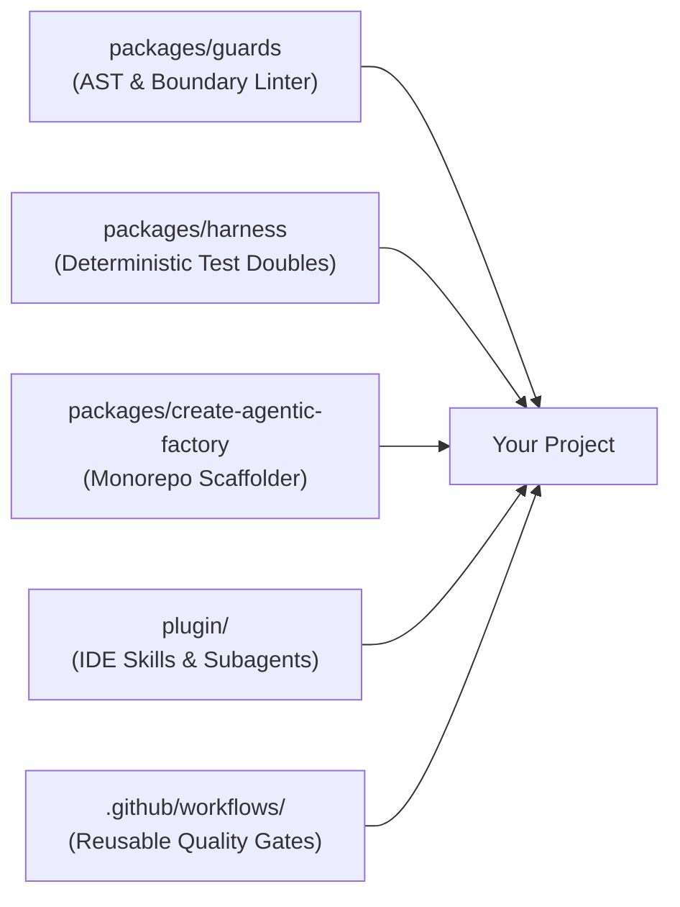

# Agentic Factory

> **The Project-Agnostic Software Factory and Harness Engine for Agentic Software Development.**

[](LICENSE)
[](tsconfig.base.json)

---

## What is Agentic Factory?

When building software with AI coding agents, **the AI model is only 10%** of the equation: the remaining **90% is the harness** (tooling, AST guardrails, synthetic test doubles, and architectural boundaries).

`agentic-factory` provides that missing 90%:
* **Automated Guardrails (`@agentic-factory/guards`):** Pure-TypeScript AST cycle detection, package boundary enforcement, plain-language UX checks, and secret scanning.
* **Synthetic Testing Harness (`@agentic-factory/harness`):** Seeded PRNG, virtual clocks, and contract test runners (zero PII, zero flakiness).
* **Antigravity IDE Plugin:** Pre-bundled SDLC skills and autonomous subagents (`SpecArchitect`, `HarnessEngineer`, `GuardEnforcer`, `AdversarialReviewer`).
* **Turnkey Scaffolder (`create-agentic-factory`):** Monorepo generator configured with composite TypeScript, BDD docs, and boundary rules.

---

## Quick Start: 4 Ways to Use It

### 1. Scaffold a New Project

Generate a production-ready, agent-friendly project in one command:

```bash
# From NPM (published):
npx create-agentic-factory my-app --arch modular-monorepo

# Or directly from source:
git clone https://github.com/vantrangradion/agentic-factory.git
cd agentic-factory && pnpm install && pnpm build
node packages/create-agentic-factory/dist/cli.js my-app --arch modular-monorepo
```

This sets up:
* Composite `tsconfig.json` & `pnpm-workspace.yaml` (sub-second incremental builds)
* Pure domain contract package (`packages/types`)
* Seeded synthetic scenario runner (`packages/testing`)
* Standard docs (`spec.md`, `user-stories.md` with BDD Gherkin, ADR decisions)
* Invariant guard configuration (`.factoryrc.json`)

---

### 2. Add Guards to an Existing Project

Add deterministic architectural guards to any current codebase:

**Step 1: Install the guard engine:**
```bash
pnpm add -D @agentic-factory/guards
```
*(Or link locally: `"@agentic-factory/guards": "link:../agentic-factory/packages/guards"`)*

**Step 2: Generate `.factoryrc.json`:**
```bash
pnpm agentic-guards init                      # style-neutral defaults
pnpm agentic-guards init --preset plain-ux    # also enforce plain-language UX copy
```

Or write it by hand. The engine is generic; everything project-specific is data:
```json
{
  "$schema": "https://agentic-factory.dev/schema.json",
  "extends": ["agentic-factory/recommended"],
  "project": { "name": "my-app", "architecture": "modular-monorepo", "languages": ["typescript", "python"] },
  "guards": {
    "noCycles": { "rootDir": "packages" },
    "boundaries": [
      {
        "package": "packages/domain",
        "disallowImportsFrom": ["packages/adapters", "packages/infrastructure"]
      }
    ]
  }
}
```

* **Languages:** files are routed to a language adapter by extension. Supported today: `typescript` (TS/JS, via the TypeScript compiler, an optional peer dependency) and `python` (no dependencies). Omit `project.languages` to check every supported language present.
* **Presets:** `agentic-factory/recommended` (cycles, secrets, TODO links, commented-out code, dead exports) and `agentic-factory/plain-ux` (jargon list, no em dashes or emojis in user-facing copy). `extends` also accepts relative paths, so an organization can share one base config. Your own settings always win; arrays replace rather than merge.
* **Coverage:** every guard runs on every supported language, except dead exports, which is TypeScript-only for now and reports skipped files instead of passing silently.

**Step 3: Run the guards:**
```bash
pnpm agentic-guards run
```

---

### 3. Enable the Antigravity IDE Plugin

Equip your Antigravity IDE with global factory intelligence across all your projects:

```bash
# Clone the repository
git clone https://github.com/vantrangradion/agentic-factory.git ~/agentic-factory

# Link to Antigravity's global plugin directory
mkdir -p ~/.gemini/config/plugins
ln -sfn ~/agentic-factory/plugin ~/.gemini/config/plugins/agentic-factory
```

**Instant access to skills & subagents in chat:**
* `/agentic-sdlc`: SDLC rules and harness engineering principles.
* `/factory-harness`: 5-phase harness setup checklists.
* `/architecture-decision`: ADR trade-off analyzer.
* `/user-story-authoring`: Spec-to-BDD story decomposition.
* `/milestone-watchdog`: Rebuild a story batch's state from git and GitHub, report what needs attention, and safely resume interrupted or rejected work.
* **Subagents:** `SpecArchitect`, `HarnessEngineer`, `GuardEnforcer`, `AdversarialReviewer`.
* **The 7-Step Story Lifecycle:** Accept (Definition of Ready) -> Plan (draft PR) -> Red Phase (TDD) -> Green Phase (Self-Healing) -> Guard Phase (`agentic-guards`) -> Adversarial Audit -> Ready for Review & Human Sign-Off. The plan and the finished PR are both reviewed asynchronously, so batches never stall waiting for approval.

---

### 4. Enforce Quality Gates in GitHub CI

Block regressions automatically on every Pull Request:

```yaml
# .github/workflows/ci.yml
name: CI Quality Gate
on: [push, pull_request]

jobs:
  agentic-guards:
    uses: vantrangradion/agentic-factory/.github/workflows/reusable-guard-ci.yml@main
```

---

## Synthetic Testing Example

Write deterministic, zero-PII unit tests using `@agentic-factory/harness`:

```typescript
import { ScenarioBuilder, MockClock, PRNG } from '@agentic-factory/harness';

// Reproducible fixture with deterministic time advance
const clock = new MockClock(1700000000000);
const builder = new ScenarioBuilder<PaymentEvent>(42);

const events = builder.generate(5, (idx, prng, clock) => ({
  transactionId: prng.uuid(),
  amount: prng.nextInt(10, 500),
  timestamp: clock.now(),
})).build();
```

---

## Architecture



---

## License

MIT © Antigravity Engineering
