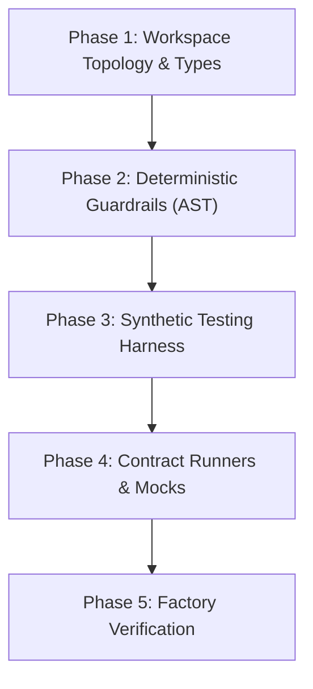

# Factory Model & Harness Engineering Skill

Use this skill whenever setting up a new repository foundation, scaffolding monorepo packages, building deterministic AST guardrails, constructing synthetic testing harnesses, or preparing the testing environment for autonomous agent implementation.

---

## 1. The 5 Harness Scaffolding Phases



### Phase 1: Workspace Topology & Shared Types
* Define workspace topology (e.g. `pnpm-workspace.yaml`).
* Configure TypeScript project references with `composite: true` for sub-second incremental compilation.
* Centralize domain contracts and event interfaces in `packages/types` before implementing any feature package.

### Phase 2: Deterministic Guardrails & AST Linters
* Never rely solely on LLM prompt obedience for hard architectural rules. Enforce via deterministic AST scripts:
  * **Zero Circular Dependencies:** Run `agentic-guards cycles`.
  * **Strict Boundary Isolation:** Run `agentic-guards boundaries`.
  * **Plain Language UX Linter:** Run `agentic-guards jargon`.
  * **Secret & PII Scanner:** Run `agentic-guards secrets`.

### Phase 3: Synthetic Testing Harness
* Implement scenario builders with seeded PRNG (`ScenarioBuilder`) and virtual clocks (`MockClock`).
* **Privacy Boundary:** Never use real customer data or credentials in fixtures. Generate synthetic streams.

### Phase 4: Parameterized Contract Runners & Mock Servers
* Build reusable contract test suites (`executeContractSuite`) executed against any adapter implementation.
* Build local mock servers for third-party HTTP/WebSocket APIs.

### Phase 5: Factory Self-Verification Run
Execute the complete verification pipeline before writing any production feature code:
```bash
pnpm clean && pnpm build && pnpm guard && pnpm test
```
All packages must compile with zero warnings, all guards pass, and test suite completes in under 2 seconds.

