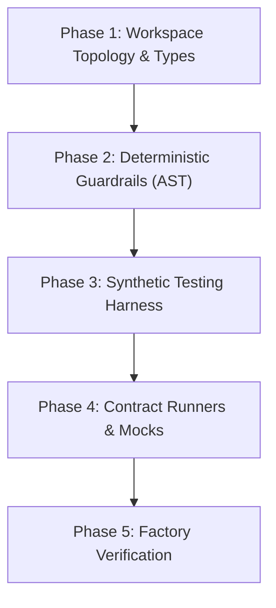

# Factory Model & Harness Engineering Skill

Use this skill whenever setting up a new repository foundation, scaffolding monorepo packages, building deterministic AST guardrails, constructing synthetic testing harnesses, or preparing the testing environment for autonomous agent implementation.

---

## 1. The 5 Harness Scaffolding Phases



### Phase 1: Workspace Topology & Shared Types
* Define workspace topology (e.g. `pnpm-workspace.yaml`).
* Configure TypeScript project references with `composite: true` for sub-second incremental compilation.
* Centralize domain contracts and event interfaces in `packages/types` before implementing any feature package.

### Phase 2: Deterministic Guardrails & AST Linters
* Never rely solely on LLM prompt obedience for hard architectural rules. Enforce via deterministic AST scripts:
  * **Zero Circular Dependencies:** Run `agentic-guards cycles`.
  * **Strict Boundary Isolation:** Run `agentic-guards boundaries`.
  * **Plain Language UX Linter:** Run `agentic-guards jargon`.
  * **Secret & PII Scanner:** Run `agentic-guards secrets`.

### Phase 3: Synthetic Testing Harness
* Implement scenario builders with seeded PRNG (`ScenarioBuilder`) and virtual clocks (`MockClock`).
* **Privacy Boundary:** Never use real customer data or credentials in fixtures. Generate synthetic streams.

### Phase 4: Parameterized Contract Runners & Mock Servers
* Build reusable contract test suites (`executeContractSuite`) executed against any adapter implementation.
* Build local mock servers for third-party HTTP/WebSocket APIs.

### Phase 5: Factory Self-Verification Run
Execute the complete verification pipeline before writing any production feature code:
```bash
pnpm clean && pnpm build && pnpm guard && pnpm test
```
All packages must compile with zero warnings, all guards pass, and test suite completes in under 2 seconds.

---

## 2. Operational Story Execution Runbook

Once the factory floor is verified, execute user stories using the **7-Step Story Lifecycle**. It has two human checkpoints: the plan and its failing tests are approved before any implementation starts (blocking), and the finished PR is reviewed before merge. The `@agentic-factory/loop` package (`agentic-loop run-issue` or `watch`) runs this lifecycle and enforces it in code.

1. **Accept (Definition of Ready):**
   - Developer assigns the story (or a milestone batch).
   - Agent loads the BDD scenarios, ADRs, and boundary rules, then confirms the story is ready: every acceptance criterion is testable, every dependency story is merged or is the branch this one builds on, and no open questions or non-automatable human gates remain.
   - If any check fails, do not start. Report exactly what is missing and move to the next ready story in the batch.
2. **Red Phase (Test First):**
   - Agent authors unit or contract tests matching Gherkin acceptance criteria, changing test files only.
   - Runs tests and confirms expected failure (`Red`) using synthetic data, then commits them.
3. **Plan Approval (blocking):**
   - Push the red commit and open a draft PR (`gh pr create --draft`) whose body starts with a `## Plan` section: approach, files to change, interfaces, edge cases covered by the tests, and risks or open questions.
   - Stop. Nothing is implemented until a person approves (the `agent:plan-approved` label). To reject, a reviewer comments or requests changes on the draft and re-labels the story `agent:ready`; the next red phase receives those comments.
4. **Green Phase & Autonomous Feedback Loop:**
   - Agent implements minimal production code on the approved branch. The approved tests are locked: any edit to them is reverted.
   - If tests or compiler fail, the gate output goes back to the agent, which iterates to `Green` within the attempt limit.
5. **Deterministic Guard Verification:**
   - The project's gates run cheapest first (`pnpm guard` or the configured equivalent): cycle limits, package boundaries, UX language rules, secret scanning, then tests.
6. **Independent Review (by exception):**
   - Only for stories labelled risky (configurable). A separate reviewer session (the `AdversarialReviewer` role) checks the diff against the issue, treating the coding agent's summary as claims to verify. Findings are classified as gap, bug, verification-miss, or scope-drift.
   - Advisory only: it never blocks a merge. High and medium findings get one fix round, kept only if every gate still passes, and not reviewed again.
7. **Ready for Review & Human Sign-Off:**
   - Agent appends Red/Green logs, guard results, any review findings, and a `## Deviations from Plan` section (or "None") to the PR body, then marks it ready (`gh pr ready`).
   - Agent marks the story done in the backlog only after the developer merges.

**If a plan is rejected:** re-plan from step 2 with the reviewers' comments, then rebase every dependent story branch onto the revised one and re-run its tests and guards. The `milestone-watchdog` skill detects this state.
