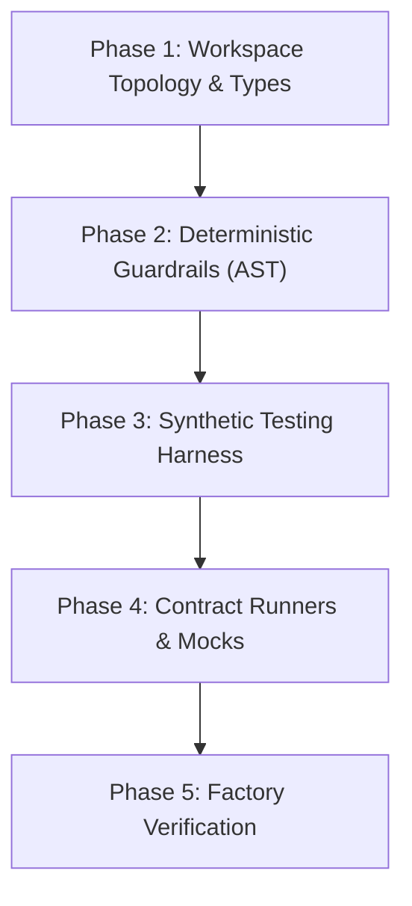

# Factory Model & Harness Engineering Skill

Use this skill whenever setting up a new repository foundation, scaffolding monorepo packages, building deterministic AST guardrails, constructing synthetic testing harnesses, or preparing the testing environment for autonomous agent implementation.

---

## 1. The 5 Harness Scaffolding Phases



### Phase 1: Workspace Topology & Shared Types
* Define workspace topology (e.g. `pnpm-workspace.yaml`).
* Configure TypeScript project references with `composite: true` for sub-second incremental compilation.
* Centralize domain contracts and event interfaces in `packages/types` before implementing any feature package.

### Phase 2: Deterministic Guardrails & AST Linters
* Never rely solely on LLM prompt obedience for hard architectural rules. Enforce via deterministic AST scripts:
  * **Zero Circular Dependencies:** Run `agentic-guards cycles`.
  * **Strict Boundary Isolation:** Run `agentic-guards boundaries`.
  * **Plain Language UX Linter:** Run `agentic-guards jargon`.
  * **Secret & PII Scanner:** Run `agentic-guards secrets`.

### Phase 3: Synthetic Testing Harness
* Implement scenario builders with seeded PRNG (`ScenarioBuilder`) and virtual clocks (`MockClock`).
* **Privacy Boundary:** Never use real customer data or credentials in fixtures. Generate synthetic streams.

### Phase 4: Parameterized Contract Runners & Mock Servers
* Build reusable contract test suites (`executeContractSuite`) executed against any adapter implementation.
* Build local mock servers for third-party HTTP/WebSocket APIs.

### Phase 5: Factory Self-Verification Run
Execute the complete verification pipeline before writing any production feature code:
```bash
pnpm clean && pnpm build && pnpm guard && pnpm test
```
All packages must compile with zero warnings, all guards pass, and test suite completes in under 2 seconds.

---

## 2. Operational Story Execution Runbook

Once the factory floor is verified, execute user stories using the **7-Step Story Lifecycle**. It has two human checkpoints, both asynchronous so milestone batches keep moving: the plan is reviewed in a draft PR before code lands, and the finished PR is reviewed before merge.

1. **Accept (Definition of Ready):**
   - Developer assigns the story (or a milestone batch).
   - Agent loads the BDD scenarios, ADRs, and boundary rules, then confirms the story is ready: every acceptance criterion is testable, every dependency story is merged or is the branch this one builds on, and no open questions or non-automatable human gates remain.
   - If any check fails, do not start. Report exactly what is missing and move to the next ready story in the batch.
2. **Plan in a Draft PR:**
   - Create the story branch, push a plan commit (`git commit --allow-empty -m "plan(<story-id>): <title>"`), and open a draft PR (`gh pr create --draft`).
   - The PR body starts with a `## Plan` section: affected files, interfaces, synthetic test scenarios, edge cases, and risks.
   - Continue immediately; do not wait for approval. A reviewer rejects the plan by requesting changes on the draft PR.
3. **Red Phase (Test First):**
   - Agent authors unit or contract tests matching Gherkin acceptance criteria.
   - Runs tests and confirms expected failure (`Red`) using synthetic data.
4. **Green Phase & Autonomous Feedback Loop:**
   - Agent implements minimal production code.
   - If tests or compiler fail, agent autonomously diagnoses error traces and iterates to `Green`.
5. **Deterministic Guard Verification:**
   - Agent runs the project's guards (`pnpm guard` or the configured equivalent) to enforce cycle limits, package boundaries, UX language rules, and secret scanning.
6. **Adversarial Audit & Trajectory Review:**
   - The decoupled `AdversarialReviewer` agent audits the diff against the acceptance criteria, ADR compliance, the `## Plan` in the PR, and the 20% edge cases (unhandled errors, rate limits, resource cleanup).
7. **Ready for Review & Human Sign-Off:**
   - Agent appends Red/Green logs, guard results, the audit report, and a `## Deviations from Plan` section (or "None") to the PR body, then marks it ready (`gh pr ready`).
   - Agent marks the story done in the backlog only after the developer merges.

**If a plan is rejected after work has moved on:** revise the plan in the PR body, restart that story from step 3, then rebase every dependent story branch onto the revised one and re-run its tests and guards. The `milestone-watchdog` skill detects this state.
