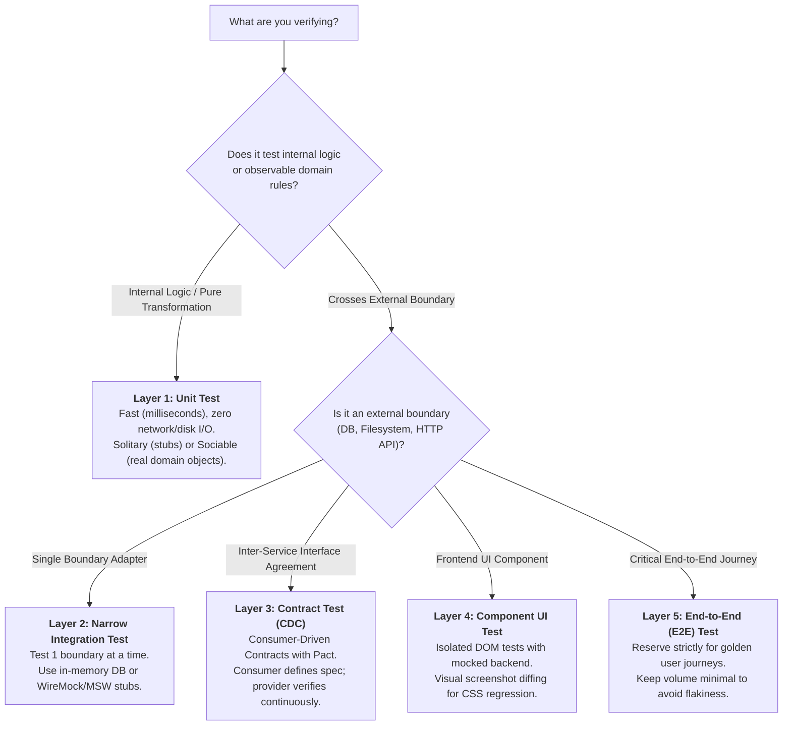

# Practical Test Pyramid Skill

Use this skill whenever designing automated test suites, choosing between unit vs. integration vs. contract tests, selecting test double strategies (solitary vs. sociable), refactoring awkward-to-test code, or structuring deployment pipeline test gates.

Full technical reference: [`docs/practical-test-pyramid.md`](../../docs/practical-test-pyramid.md)

---

## 1. Core Mental Models & Rules of Thumb

1. **The Volume Inversion Rule:**
   $$\text{Test Volume} \propto \frac{1}{\text{Execution Cost} \times \text{Execution Duration}}$$
   * Write lots of small, fast, isolated **Unit Tests**.
   * Write some more coarse-grained **Integration & Contract Tests**.
   * Write very few broad **End-to-End Tests**.

2. **The Golden Rules of Test Pyramid Hygiene:**
   * **Rule 1 (Down-Pushing):** If a higher-level test detects an error and no lower-level test fails, write a lower-level test reproducing the error before fixing the code.
   * **Rule 2 (Anti-Duplication):** Push tests as far down the pyramid as possible. If lower-level tests cover all edge cases, delete the redundant assertions from the higher-level test.
   * **Rule 3 (Sunk Cost Fallacy):** Ruthlessly prune slow, flaky, or redundant E2E tests even if they took days to author.

---

## 2. Test Classification Decision Tree

When adding verification for a feature, use this decision tree to place your test at the lowest viable tier:



---

## 3. Solitary vs. Sociable & Test Double Taxonomy

### Solitary vs. Sociable Decision Heuristic
* **Sociable Tests (Default for Domain Logic):** Use real collaborating classes if they are pure, fast, in-memory objects. Gives high confidence and refactoring resilience.
* **Solitary Tests (Default for Orchestration / High Setup):** Substitute collaborators with mocks/stubs when real collaborators have complex state, asynchronous lifecycles, or awkward dependencies.

### Test Double Selection Guide

| Double Type | When to Use | Mechanism |
| :--- | :--- | :--- |
| **Dummy** | Satisfying strict type signatures or required method arguments. | Unused object, empty string, `null` placeholder. |
| **Stub** | SUT requires pre-canned data to exercise conditional branches. | Returns predetermined output: `given(repo.find(x)).willReturn(y)`. |
| **Spy** | Verifying indirect side-effects without modifying real behavior. | Wraps target and records calls (`callsCount`, arguments passed). |
| **Mock** | Strict interaction verification where calling sequence is the contract. | Pre-programmed with expected calls; fails if extra calls occur. |
| **Fake** | Simulating persistent state without production dependencies. | In-memory map or array implementing repository interface. |

---

## 4. Code Smells & Anti-Pattern Playbooks

### Smell 1: Desperately Wanting to Test a Private Method
* **Diagnosis:** This is a **design problem (Single Responsibility Principle violation)**, not a test visibility problem. The class is doing too much.
* **Remedy:**
  1. Extract the private method and its associated state into a separate class.
  2. Make the method public on the new class.
  3. Inject the new collaborator into the original class.
  4. Test the extracted collaborator directly through its public interface.

### Smell 2: Testing Implementation Details Instead of Observable Behavior
* **Symptom:** Refactoring internal private variables or helper methods breaks unit tests even though public inputs and outputs remain unchanged.
* **Remedy:** Treat the SUT as a black box:
  $$\mathbf{Test:} \quad \text{Input } (x, y) \implies \text{Output } z$$
  $$\mathbf{Do\ Not\ Test:} \quad \text{Assert that private helper } h_1() \text{ ran before } h_2().$$

### Smell 3: The Iceberg / Inverted Pyramid (Hourglass)
* **Symptom:** Hundreds of slow, flaky browser E2E tests; sparse unit test coverage; multi-hour CI pipeline runs.
* **Remedy:** Freeze new E2E tests. Decompose flaky E2E tests into isolated unit tests (for logic) and narrow integration tests (for API boundaries). Delete the flaky E2E tests once lower-level coverage is confirmed.

---

## 5. Clean Test Code Protocol

1. **Strict Three-Phase Structure:** Every test must visually separate **Arrange (Given)**, **Act (When)**, and **Assert (Then)**:
   ```typescript
   // Arrange
   const peter = new Person('Peter', 'Pan');
   repoStub.findByLastName.mockResolvedValue(peter);

   // Act
   const greeting = await controller.hello('Pan');

   // Assert
   expect(greeting).toBe('Hello Peter Pan!');
   ```
2. **One Assertion Concept Per Test:** Test one logical outcome per test case. Multiple technical assertions are fine if they verify facets of the same logical state.
3. **DAMP Over DRY:** In test code, prioritize **Descriptive And Meaningful Phrases (DAMP)** over extreme DRY. Repeating minor test setup is preferable to convoluted, multi-level test inheritance hierarchies.
4. **Use Test Data Builders:** Never construct 10-parameter domain entities inline. Provide builder classes with realistic defaults.
5. **The Rule of Three:** Duplicate test fixtures twice. Only build reusable helpers or custom matchers upon the third identical use.

---

## 6. Pipeline Stage Ordering Heuristic

Structure CI/CD pipelines strictly by **Execution Speed and Scope**, not formal labels:

```
Commit / Fast Stage (< 5 min)
├── Solitary & Sociable Unit Tests (Vitest)
└── Fast In-Memory DB Integration Tests (SQLite / SQLCipher)
      │
Acceptance & Contract Stage (< 15 min)
├── WireMock / Mock Margince Contract Tests
├── Isolated UI Component Tests (Testing Library)
└── Lint & Boundary AST Guards
      │
Staging & Broad Stack Stage (< 30 min)
├── Smoke E2E Tests (REST Assured / Playwright)
└── Visual Screenshot Regression Diffs
```

