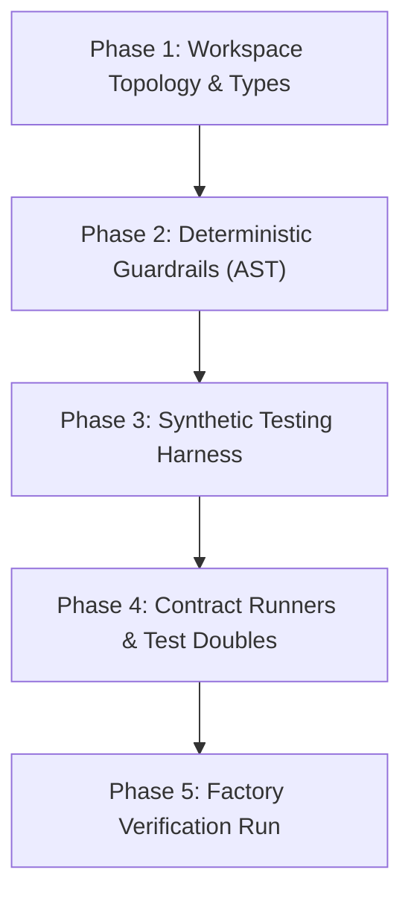

# {{PROJECT_NAME}} — Factory Model & Harness Engineering Setup Checklist

**Milestone:** Sprint 0 / Foundation Setup  
**Core Law:** $\mathbf{Agent = Model + Harness}$

---

## The 5 Scaffolding Phases

### Phase 1: Workspace Topology & Types
- [ ] Root `pnpm-workspace.yaml` and `tsconfig.base.json` configured.
- [ ] `packages/types` defined with zero runtime dependencies.
- [ ] TypeScript project references wired with `composite: true`.

### Phase 2: Deterministic Guardrails & Linters
- [ ] `.factoryrc.json` configured with architectural boundaries.
- [ ] `pnpm guard` passes: zero circular dependencies, zero secret leaks.
- [ ] Plain-language UX linter checks user-facing surfaces.

### Phase 3: Synthetic Testing Harness
- [ ] `ScenarioBuilder` with seeded PRNG initialized in `packages/testing`.
- [ ] Virtual clock (`MockClock`) implemented for time-dependent operations.
- [ ] Zero production customer data or PII used in fixtures.

### Phase 4: Parameterized Contract Runners
- [ ] Reusable contract test suites defined for external ports/adapters.
- [ ] Mock servers configured for third-party HTTP/WebSocket dependencies.

### Phase 5: Self-Verification
- [ ] Run full pipeline: `pnpm clean && pnpm build && pnpm guard && pnpm test`.
- [ ] Total execution under 2 seconds. Ready for autonomous story implementation.

