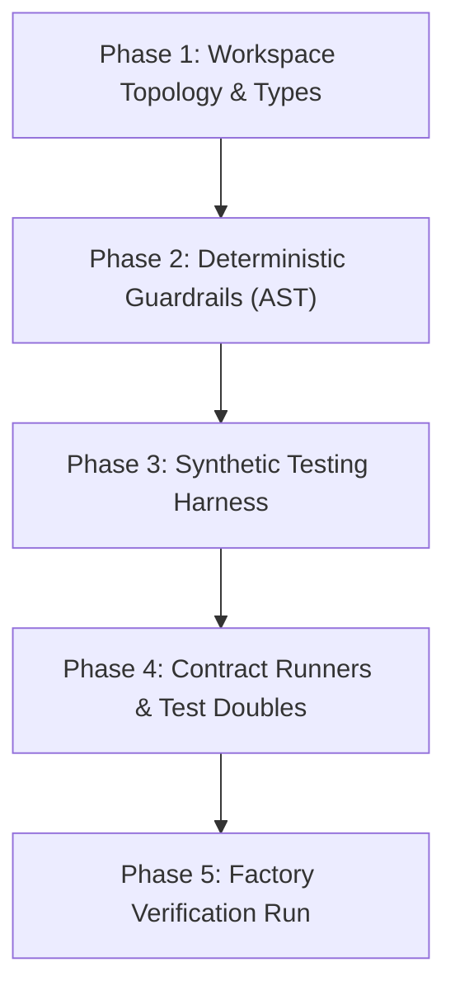
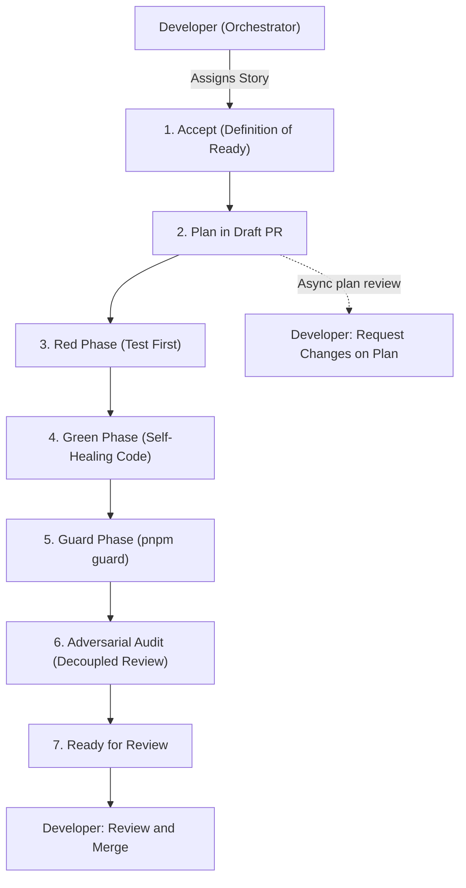

# {{PROJECT_NAME}}: Factory Model & Harness Engineering Setup Checklist

**Milestone:** Sprint 0 / Foundation Setup  
**Core Law:** $\mathbf{Agent = Model + Harness}$

---

## The 5 Scaffolding Phases

### Phase 1: Workspace Topology & Types
- [ ] Root `pnpm-workspace.yaml` and `tsconfig.base.json` configured.
- [ ] `packages/types` defined with zero runtime dependencies.
- [ ] TypeScript project references wired with `composite: true`.

### Phase 2: Deterministic Guardrails & Linters
- [ ] `.factoryrc.json` configured with architectural boundaries.
- [ ] `pnpm guard` passes: zero circular dependencies, zero secret leaks.
- [ ] Plain-language UX linter checks user-facing surfaces.

### Phase 3: Synthetic Testing Harness
- [ ] `ScenarioBuilder` with seeded PRNG initialized in `packages/testing`.
- [ ] Virtual clock (`MockClock`) implemented for time-dependent operations.
- [ ] Zero production customer data or PII used in fixtures.

### Phase 4: Parameterized Contract Runners
- [ ] Reusable contract test suites defined for external ports/adapters.
- [ ] Mock servers configured for third-party HTTP/WebSocket dependencies.

### Phase 5: Self-Verification
- [ ] Run full pipeline: `pnpm clean && pnpm build && pnpm guard && pnpm test`.
- [ ] Total execution under 2 seconds. Ready for autonomous story implementation.

---

## Operational Runbook: The 7-Step Story Lifecycle

When picking up a user story from `docs/user-stories.md`:

### The 7 Steps:
1. **Accept (Definition of Ready):** Load BDD criteria, ADRs, and boundary rules. Confirm every criterion is testable, dependencies are merged or are the base branch, and no human gate remains. Otherwise report what is missing and do not start.
2. **Plan in a Draft PR:** Push a plan commit and open a draft PR whose body starts with `## Plan` (affected files, interfaces, test scenarios, edge cases, risks). Continue without waiting.
3. **Red Phase (Test First):** Write tests with synthetic doubles; verify failure (`Red`).
4. **Green Phase & Feedback Loop:** Write minimal production code; autonomously diagnose and patch test failures until passing (`Green`).
5. **Deterministic Guardrails:** Execute `pnpm guard` to enforce zero circular dependencies, boundary isolation, and secret scanning.
6. **Adversarial Audit:** The decoupled `AdversarialReviewer` audits the diff against BDD acceptance criteria, ADR compliance, the plan, and edge-case failure paths.
7. **Ready for Review:** Add test logs, guard results, the audit report, and `## Deviations from Plan` to the PR, then mark it ready. The backlog checkbox is ticked only after merge.

---

## Responsibility Matrix: Automation vs. Human Control

| Lifecycle Phase | Autonomous (Agent & Harness) | Human Control (Developer) |
| :--- | :--- | :--- |
| **Story Selection** | None | Selects target story from backlog based on priority |
| **Accept** | Checks the Definition of Ready and reports gaps | Assigns stories and resolves open questions |
| **Plan (Draft PR)** | Publishes the plan in a draft PR and continues | Requests changes on the draft if the plan is wrong |
| **Test Authoring (Red)** | Generates Vitest assertions from Gherkin specifications | Reviews test strategy if architecture changes |
| **Implementation (Green)**| Writes minimal production code | Steers trade-offs if multiple paths exist |
| **Self-Healing** | Parses error traces, diagnoses bugs, and iterates code | Steps in only if an external spec flaw is discovered |
| **Quality Gates** | Runs AST linters, cycle detectors, and boundary guards | Configures project tolerances in .factoryrc.json |
| **Adversarial Audit** | Evaluates diff against edge cases and acceptance criteria | Validates audit findings and assesses business risk |
| **Final Sign-Off** | Marks the PR ready with logs, audit, and plan deviations | Reviews, approves, and merges; backlog is ticked after merge |

