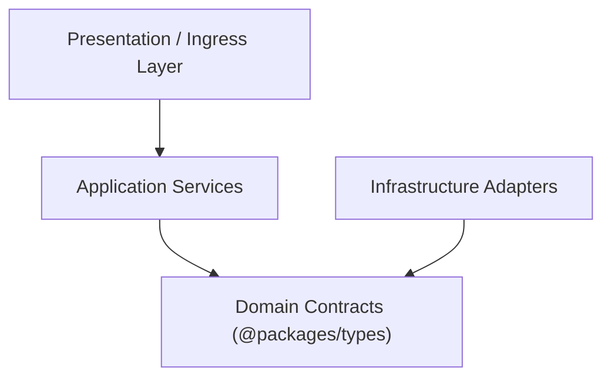

# {{PROJECT_NAME}}: Product & Technical Specification

**Version:** 0.1.0-draft  
**Status:** In Review  
**Architecture:** {{ARCHITECTURE}}  

---

## 1. Executive Summary

A concise description of the product purpose, problem domain, and target users.

---

## 2. Core Invariants & Boundaries

1. **Deterministic Guardrails:** Zero circular dependencies, zero architectural boundary violations.
2. **Domain Isolation:** Core interfaces and business rules have zero dependencies on external frameworks or databases.
3. **Privacy by Design:** Zero real customer PII or production credentials in development/test environments.

---

## 3. High-Level Architecture

---

## 4. Key Contracts & Interfaces

Defined in [`packages/types/src/index.ts`](../packages/types/src/index.ts).

---

## 5. Non-Functional Requirements (NFRs)

* **Performance:** Unit test suite must execute in $< 2$ seconds.
* **Security:** All endpoints validated with strict schemas; secrets scanned pre-commit.
* **Reliability:** Idempotent retry logic and circuit breakers for external network boundaries.

